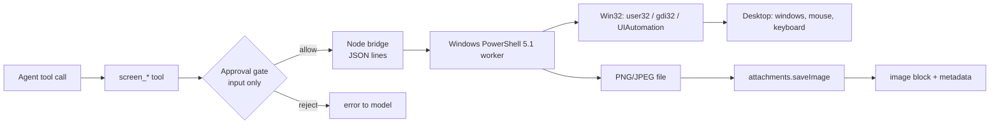

# dsh-screen-control

[](https://github.com/OWNER/dsh-screen-control/actions/workflows/ci.yml)
[](LICENSE)
[](#requirements)
[](#install)

**Windows screen control for DeepSeek Harness.** Six `screen_*` tools let an agent look at this desktop and drive it like a person: screenshot, move/click/drag/scroll the real mouse, type Unicode text, send key chords, read the UI Automation tree, focus windows, and wait for UI changes.

Like Codex's computer-use plugin, but built for DSH on Windows with **no dependencies, no MCP server, no compiler**: a single Windows PowerShell 5.1 worker does the Win32 work, and the agent gets first-class tools, approval gating, and an emergency stop.

[中文说明](README.zh-CN.md) · [Tools](docs/tools.md) · [Architecture](docs/architecture.md) · [Verification](docs/verification.md)

---

## Features

- **Look** — full virtual desktop, one window (works while covered, via `PrintWindow`), or a rectangle; PNG/JPEG with optional downscale and a cursor crosshair.
- **Act** — click, double/right/middle click, drag with interpolation, wheel scroll, Unicode typing (Chinese, emoji), key chords such as `ctrl+shift+t`.
- **Understand** — UI Automation tree with control type, name, automation id, rectangle, enabled/off-screen state and values; window list with process names and rectangles.
- **Image-aware** — when the routed model accepts images, the screenshot is committed through the attachment service and returned as a real image block; text-only routes get the file path plus metadata instead.
- **Safe by default** — desktop input is gated by `inputPolicy: "ask"` (one approval per session), `Ctrl+Alt+Esc` stops all input for 30 s, and every call reports the cursor position it actually read back.
- **Cheap to run** — one long-lived worker per profile, serialized requests (~100 ms per action after the first), automatic restart, one-shot fallback when the host forbids piped stdio.

## Requirements

- Windows 10 or Windows 11 with an interactive desktop session.
- DeepSeek Harness (tested with 0.2.1-rc.2).
- Windows PowerShell 5.1 (`powershell.exe`), which ships with Windows. PowerShell 7 is not required.
- Optional: a model that declares image input, for screenshot understanding. Text-only models can still work through `screen_ui`.

## Install

### From GitHub (recommended)

```sh
dsh plugin add github:OWNER/dsh-screen-control
```

### From a local checkout

```sh
git clone https://github.com/OWNER/dsh-screen-control.git
dsh plugin add /absolute/path/to/dsh-screen-control
```

In the desktop app, the equivalent is **Settings → Plugins → Install bundle** with the directory as the target.

### From a release tarball

```sh
dsh plugin add https://github.com/OWNER/dsh-screen-control/releases/latest/download/dsh-screen-control.tgz
```

After installing, the tools appear on the next turn. The plugin row is called **Screen Control** in Settings → Plugins.

## Quick start

Ask the agent for an outcome, not a keystroke:

> Open Notepad, type a haiku about the sea, and screenshot the result.

A typical tool sequence:

1. `screen_windows { action: "list", title: "记事本" }` — is the target already open?
2. `screen_capture { window: "记事本" }` — look before acting.
3. `screen_pointer { action: "click", x: 640, y: 520 }` — click the text area.
4. `screen_keyboard { action: "type", text: "…" }` — type.
5. `screen_capture { window: "记事本" }` — verify the text is really there.

Pixels picked from a screenshot can be reused directly:

```jsonc
// 1) capture returns: source {x:0,y:0,width:2560,height:1600}, scale 0.625
{ "name": "screen_capture", "arguments": { "max_width": 1600 } }

// 2) click the pixel you saw in that image — the plugin maps it back to the screen
{ "name": "screen_pointer", "arguments": { "action": "click", "x": 400, "y": 300, "coordinate_space": "image" } }
```

## Tools

| Tool | What it does |
| --- | --- |
| `screen_capture` | Screenshot the desktop, a window, or a region; returns path, geometry and (for image-capable models) the image. |
| `screen_pointer` | Move, click, double/right/middle click, drag, scroll. Screen or image coordinates. |
| `screen_keyboard` | Type Unicode text, send a key chord, or paste through the clipboard. |
| `screen_windows` | List top-level windows or focus one by title/handle. |
| `screen_ui` | Read the UI Automation tree of a window as text, with rectangles. |
| `screen_wait` | Sleep, or wait for a window title to appear. |

Full parameter and return contracts: [docs/tools.md](docs/tools.md).

## Configuration

The plugin row accepts these keys (all optional; defaults shown):

```yaml
inputPolicy: ask            # ask | allow | deny
capture:
  maxWidth: 1600            # downscale screenshots to this width
  format: png               # png | jpeg
  quality: 82               # jpeg quality
  keepShots: 20             # reserved for capture retention
failsafe:
  enabled: true
  hotkey: ctrl+alt+esc
  cooldownMs: 30000
bridge:
  command: ''               # override the powershell.exe path
  timeoutMs: 15000          # per-action timeout
  restartLimit: 2           # consecutive worker restarts allowed
  idleTimeoutSec: 1800      # worker exits after this much idle time
```

`inputPolicy`:

- `ask` — default. The first pointer or keyboard action in a session asks for approval; the grant is remembered for that session.
- `allow` — no prompts (only for fully trusted sessions).
- `deny` — read-only: screenshots, window and UI Automation queries still work, input is refused.

## Safety and privacy

- **Approval gate.** Desktop input is what a person's hands do; the plugin routes the first input action of a session through the harness approval channel. Screenshots and UI trees never prompt.
- **Emergency stop.** Hold `Ctrl+Alt+Esc` while any input tool runs (or before it) and input is refused for 30 seconds with `E_FAILSAFE`.
- **Elevated windows.** Windows' UIPI blocks synthetic input to processes at a higher integrity level (an administrator app). Run the harness at the same integrity level if you need to drive one; the plugin reports `E_UIPI` when it can detect the refusal.
- **Locked screen.** The secure desktop cannot be captured or driven; expect `E_LOCKED`.
- **Screenshots contain everything on screen**, including other windows. The plugin has no redaction; do not use it on a desktop with content you would not share with the model provider.
- The worker never touches the network. It receives JSON lines on stdin and returns capture files under your temp directory.

## Troubleshooting

| Symptom | Cause and fix |
| --- | --- |
| `cannot start PowerShell` | `bridge.command` is wrong, or the host forbids child processes. The bridge falls back to one-shot runs automatically. |
| `SetCursorPos failed` / `SendInput rejected input` | The process is confined by an external sandbox, or the desktop is locked. Run the harness in the interactive user session. |
| Screenshot is black | Hardware overlay, DRM-protected video, or the secure desktop. Capture the window with `window:` instead of the full screen. |
| `coordinate_space "image" needs a previous screen_capture` | Capture first; the geometry is remembered per session. |
| `E_NOT_FOUND: no visible window title contains …` | Call `screen_windows` with `action: "list"` and use the exact title substring. |
| `screen_ui` is empty | Some apps expose no automation tree (games, custom-drawn UIs). Use screenshots and coordinates instead. |

## Development

```sh
node scripts/check.mjs          # imports every module and validates resources (no child process)
node --test --test-isolation=none "test/unit/*.test.mjs"
DSH_SCREEN_E2E=1 node --test --test-isolation=none "test/e2e/*.test.mjs"
```

The e2e suite drives the real engine and briefly moves the mouse; it restores the cursor when it finishes. On CI it is skipped because the runner has no interactive desktop.

```sh
node scripts/setup-repo.mjs <your-github-owner>   # replace the OWNER placeholder
node scripts/make-entry.mjs <your-github-owner>   # regenerate the awesome-dsh-plugin entry
```

## How it works



More detail, including the JSON protocol and lifecycle rules, is in [docs/architecture.md](docs/architecture.md).

## License

[MIT](LICENSE).
