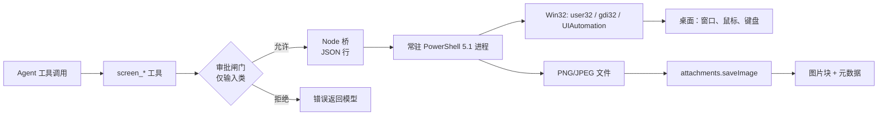

# dsh-xiangwriter-screen-control

[](https://github.com/xiangwriter-dev/dsh-xiangwriter-screen-control/actions/workflows/ci.yml)
[](LICENSE)
[](#环境要求)
[](#安装)

**给 DeepSeek Harness 的 Windows 自动控屏插件。** 六个 `screen_*` 工具让 Agent 像人一样看屏幕、动鼠标、敲键盘：截屏、移动/点击/拖拽/滚轮、输入中文与 emoji、发送组合键、读取 UI Automation 控件树、聚焦窗口、等待界面变化。

类似 Codex 的电脑操作插件，但面向 DSH 与 Windows，**零依赖、不用 MCP 服务、不用编译器**：一个常驻的 Windows PowerShell 5.1 工作进程负责全部 Win32 操作，Agent 拿到的是原生工具、输入审批和紧急停止。

[English](README.md) · [工具参考](docs/tools.md) · [架构](docs/architecture.md) · [验证记录](docs/verification.md)

---

## 功能

- **看** — 整屏、单窗口（被遮挡也能抓，走 `PrintWindow`）或任意矩形；PNG/JPEG，可缩放，可在光标处画十字标记。
- **动** — 单击、双击、右键、中键、带插值拖拽、滚轮，Unicode 文本输入（中文、emoji），`ctrl+shift+t` 这类组合键。
- **理解** — UI Automation 控件树（类型、名称、automationId、矩形、可用/离屏状态、值），窗口列表（进程名、矩形、前台标记）。
- **图像感知** — 当前模型支持图像输入时，截图经附件服务落盘并作为真正的图片块返回；纯文本模型拿到文件路径与元数据。
- **默认安全** — 输入受 `inputPolicy: "ask"` 管控（每个会话确认一次），按住 `Ctrl+Alt+Esc` 立即停止输入 30 秒，每次动作都回读真实光标位置。
- **运行便宜** — 每个 profile 一个常驻工作进程，请求串行化（首次之后单次动作约 100 ms），崩溃自动重启，宿主禁止管道时自动降级为一次性调用。

## 环境要求

- Windows 10 / Windows 11，交互式桌面会话。
- DeepSeek Harness（实测 0.2.1-rc.2）。
- Windows 自带的 PowerShell 5.1（`powershell.exe`），**不需要** PowerShell 7。
- 可选：声明图像输入的模型，用于理解截图；纯文本模型可依靠 `screen_ui` 工作。

## 安装

```sh
dsh plugin add github:xiangwriter-dev/dsh-xiangwriter-screen-control
```

本地目录安装：

```sh
git clone https://github.com/xiangwriter-dev/dsh-xiangwriter-screen-control.git
dsh plugin add /绝对路径/dsh-xiangwriter-screen-control
```

桌面端的等价操作是「设置 → 插件 → 安装包」，目标是仓库目录。安装后，插件行显示为 **屏幕控制**。

### 通过官方插件市场（Discover）安装

DSH 0.2.1-rc.2 的插件市场是**默认关闭的实验 bundle**，且没有内置索引：Discover 页读取的是你自己添加的索引 URL。启用一次（设置 → 插件 → *插件市场*，包名 `@deepseek-ai/dsh-experimental-plugin-market-bundle`），然后添加这个索引：

```
https://raw.githubusercontent.com/xiangwriter-dev/dsh-xiangwriter-screen-control/main/market/index.json
```

索引使用 Harness 的插件市场 format 1，并把版本钉在 `v0.1.0` 的 commit 上，所以从 Discover 安装得到的正是已发布的代码。条目、更新流程与校验规则见 [docs/market.md](docs/market.md)。

## 快速上手

对 Agent 说结果，而不是说按键：

> 打开记事本，写一首关于海的诗，然后截图给我看。

典型调用链：

1. `screen_windows { action: "list", title: "记事本" }` —— 目标是否已经打开；
2. `screen_capture { window: "记事本" }` —— 先看再动；
3. `screen_pointer { action: "click", x: 640, y: 520 }` —— 点进编辑区；
4. `screen_keyboard { action: "type", text: "……" }` —— 输入；
5. `screen_capture { window: "记事本" }` —— 验证文字确实出现。

截图里的像素可以直接复用：

```jsonc
// 截图返回 source {x:0,y:0,width:2560,height:1600}、scale 0.625
{ "name": "screen_capture", "arguments": { "max_width": 1600 } }

// 点你在图里看到的那个像素，插件负责换算回屏幕坐标
{ "name": "screen_pointer", "arguments": { "action": "click", "x": 400, "y": 300, "coordinate_space": "image" } }
```

## 工具

| 工具 | 作用 |
| --- | --- |
| `screen_capture` | 截取整屏、窗口或区域；返回路径、几何信息，支持图像时附带图片。 |
| `screen_pointer` | 移动、点击、双击、右键、中键、拖拽、滚轮；支持屏幕或图片坐标。 |
| `screen_keyboard` | 输入 Unicode 文本、发送组合键、剪贴板粘贴。 |
| `screen_windows` | 列出顶层窗口，或按标题/句柄聚焦。 |
| `screen_ui` | 以文本形式读取窗口的 UI Automation 控件树，含矩形。 |
| `screen_wait` | 等待固定时长，或等待某个标题的窗口出现。 |

完整参数与返回值见 [docs/tools.md](docs/tools.md)。

## 配置

```yaml
inputPolicy: ask            # ask | allow | deny
capture:
  maxWidth: 1600
  format: png               # png | jpeg
  quality: 82
  keepShots: 20
failsafe:
  enabled: true
  hotkey: ctrl+alt+esc
  cooldownMs: 30000
bridge:
  command: ''               # 覆盖 powershell.exe 路径
  timeoutMs: 15000
  restartLimit: 2
  idleTimeoutSec: 1800
```

- `ask`（默认）：每个会话第一次鼠标/键盘动作需要人工批准，批准后该会话内不再询问。
- `allow`：不询问，仅用于完全信任的会话。
- `deny`：只读——截图、窗口、UIA 仍可用，输入一律拒绝。

## 安全与隐私

- **审批闸门**：桌面输入等同于人的操作，插件会让每个会话的第一次输入走 Harness 审批通道；截图与 UIA 不打扰。
- **紧急停止**：按住 `Ctrl+Alt+Esc`，输入工具立即以 `E_FAILSAFE` 拒绝并冷却 30 秒。
- **提权窗口**：Windows UIPI 会拦截对更高完整性级别进程（管理员应用）的模拟输入；需要时请让 Harness 以相同权限运行，插件会尽量报告 `E_UIPI`。
- **锁屏**：安全桌面无法截图与操作，预期返回 `E_LOCKED`。
- **截图包含屏幕上的一切**，插件不做脱敏；不要在不希望模型服务方看到内容的桌面上使用。
- 工作进程不联网，只从 stdin 读 JSON 行，并把截图写到本地临时目录。

## 常见问题

| 现象 | 原因与处理 |
| --- | --- |
| `cannot start PowerShell` | `bridge.command` 错误，或宿主禁止子进程；插件会自动降级为一次性调用。 |
| `SetCursorPos failed` / `SendInput rejected input` | 进程被外部沙箱限制，或桌面已锁定；请在交互式用户会话中运行。 |
| 截图全黑 | 硬件覆盖层、DRM 视频或安全桌面；改用 `window:` 抓单个窗口。 |
| `coordinate_space "image" needs a previous screen_capture` | 先截图，几何信息按会话记忆。 |
| `E_NOT_FOUND: no visible window title contains …` | 先用 `screen_windows` 的 `action: "list"` 查准确标题。 |
| `screen_ui` 为空 | 部分应用不暴露自动化树（游戏、自绘界面），改用截图 + 坐标。 |

## 开发

```sh
node scripts/check.mjs                  # 导入所有模块并校验资源，不启动子进程
node scripts/run-tests.mjs              # 单元测试
node scripts/run-tests.mjs --sandboxed  # 单进程运行（受限宿主）
DSH_SCREEN_E2E=1 node scripts/run-tests.mjs e2e --sandboxed
```

`run-tests.mjs` 自己枚举测试文件，不依赖 shell 通配符或目录参数；`--sandboxed` 避免每个测试文件起一个子进程（受限宿主不允许）。

e2e 会驱动真实引擎并短暂移动鼠标，结束后恢复光标；CI 无交互桌面时自动跳过。

```sh
node scripts/setup-repo.mjs <GitHub用户名>   # 仓库迁移时重新指向元数据
node scripts/make-entry.mjs <GitHub用户名>   # 重新生成 awesome-dsh-plugin 收录条目
```

## 工作原理



协议细节与生命周期规则见 [docs/architecture.md](docs/architecture.md)。

## 许可证

[MIT](LICENSE)。
