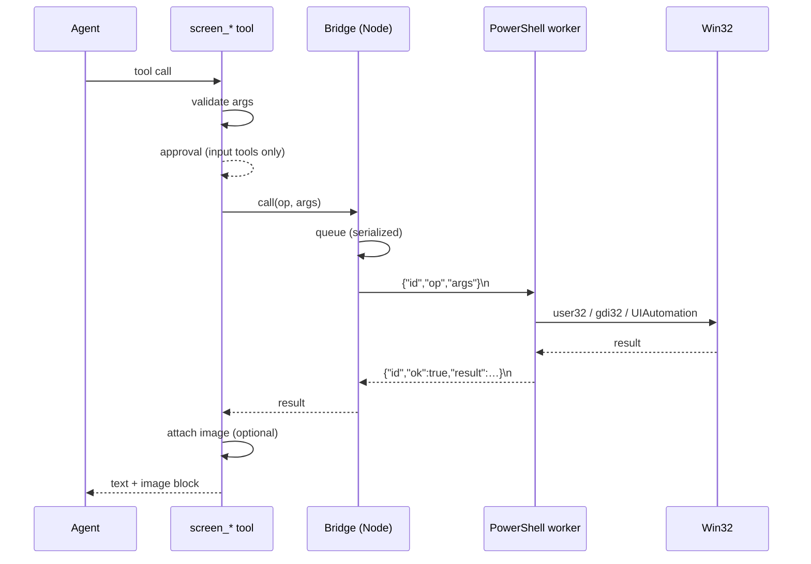

# Architecture

## Components

| Part | File | Responsibility |
| --- | --- | --- |
| Plugin entry | `index.js` | Reads config, creates the bridge, registers six tools, adds a system-prompt section, disposes the bridge. |
| Tool layer | `src/tools/*.js` | Model-facing schemas, argument validation, approval gating, image attachment, text rendering. |
| Bridge | `src/bridge.js` | Spawns and supervises `powershell.exe`, frames JSON lines, serializes requests, enforces timeouts, restarts the worker. |
| Protocol | `src/protocol.js` | ASCII-safe request encoding, response parsing, line framing. |
| Engine | `scripts/screen-control.ps1` | The only process that talks to Win32: capture, input injection, window enumeration, UI Automation. |



## JSON-lines protocol

One request per line, one response per line, correlated by `id`.

```jsonc
// request (non-ASCII escaped as \uXXXX before it reaches PowerShell)
{ "id": "7", "op": "pointer", "args": { "action": "click", "x": 640, "y": 520, "button": "left", "count": 1 } }

// success
{ "id": "7", "ok": true, "result": { "action": "click", "cursor": { "x": 640, "y": 520 } } }

// failure
{ "id": "7", "ok": false, "error": { "code": "E_LOCKED", "message": "the input desktop is not available" } }
```

Operations: `info`, `capture`, `pointer`, `keyboard`, `windows`, `ui`, `wait`.
The engine also supports `-Once -RequestFile … -ResponseFile …`, used when piped stdio is unavailable, and `-SelfTest` / `-Validate` for diagnostics and CI.

## Coordinate spaces

- The engine is per-monitor DPI aware (`SetProcessDpiAwarenessContext(-4)`), so every coordinate is a physical pixel.
- The virtual screen may start at a negative origin (a monitor left of or above the primary one); `capture` reports `source` for exactly that reason.
- A capture may be downscaled; `scale = image width / source width`. `imageToScreen` reverses it: `screen = origin + imagePixel / scale`.
- `screen_pointer` with `coordinate_space: "image"` uses the geometry remembered for the session by the most recent `screen_capture`.

## Worker lifecycle

1. The first tool call spawns `powershell.exe -NoProfile -NonInteractive -ExecutionPolicy Bypass -File scripts/screen-control.ps1`.
2. Requests are serialized through a promise queue: a click can never interleave with a drag.
3. Each request has a timeout (`bridge.timeoutMs`); a timeout kills the worker to guarantee no half-executed input, and the next call starts a fresh one.
4. A crash rejects all pending requests with `E_CRASH`-style text; consecutive restarts are capped by `bridge.restartLimit`.
5. The worker exits after `bridge.idleTimeoutSec` without requests, or when the plugin is disposed (stdin EOF).
6. If the host forbids piped child stdio, `spawn` fails with `EPERM`/`EACCES`; the bridge switches to one-shot file exchange and reports the downgrade in the log.

## Capture

1. `PrintWindow` with `PW_RENDERFULLCONTENT` for a named window (works while covered); GDI `BitBlt` from the screen DC for regions and the full desktop (`CAPTUREBLT` included so layered windows show up).
2. Optional cursor crosshair drawn in place.
3. GDI+ high-quality bicubic downscale to `maxWidth`.
4. PNG or JPEG (quality) written to `%TEMP%\dsh-xiangwriter-screen-control\shots\`.
5. The Node side reads the file, checks `attachments.imageLimits`, and commits it through `saveImage`; the returned reference becomes an `image` content block.

## Input

- Mouse: `SetCursorPos` then `SendInput` button events; drags interpolate positions every ~16 ms; wheel uses `MOUSEEVENTF_WHEEL` / `MOUSEEVENTF_HWHEEL`.
- Keyboard: `KEYEVENTF_UNICODE` per UTF-16 code unit (so IME is bypassed and arbitrary text works); chords press modifiers in order, then the key, then release in reverse.
- Failsafe: before every input operation the engine reads `GetAsyncKeyState` for Ctrl/Alt/Esc; holding all three sets a 30-second input cooldown and returns `E_FAILSAFE`.
- Approval: `inputPolicy: "ask"` routes the first input action per session through `ctx.get('approval').request(...)`; grants are cached in memory per session.

## Failure modes

| Code | Meaning | Recovery |
| --- | --- | --- |
| `E_NO_DESKTOP` / `E_LOCKED` | No interactive input desktop, or the workstation is locked. | Unlock, or run in an interactive session. |
| `E_UIPI` | A higher-integrity window blocks inspection or input. | Run at the same integrity level. |
| `E_FAILSAFE` | The emergency chord is held or the cooldown is active. | Wait for the cooldown. |
| `E_TIMEOUT` | No response within `bridge.timeoutMs` (often a hung UIA call). | The worker is killed; retry. |
| `E_NOT_FOUND` | A title substring matched no visible window. | List windows and retry with the exact title. |
| `E_ARGS` | Invalid operation arguments in the engine. | Fix the tool arguments. |
| `E_FAIL` | A Win32 call reported failure. | Inspect the message; often elevated/secure desktop. |

## Extension points

- Add an engine operation in `scripts/screen-control.ps1` (`Invoke-Op` switch) plus a Node tool in `src/tools/`.
- OCR, element-reference clicking (instead of coordinates), and capture retention are natural next steps; see the roadmap in the repository issues.
